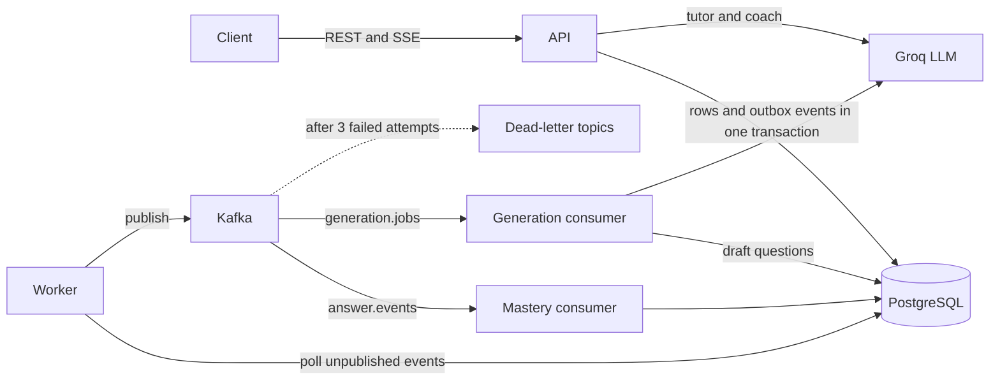

# RecallEngine

A spaced-repetition study backend in Go. Paste your notes, let AI draft questions from them, review the drafts, and study with an SM-2 schedule. Ask a tutor questions that are answered **only from your own notes**.

## Features

- **Auth:** signup and login with bcrypt, hashed session tokens, auth middleware
- **Study loop:** notes, topics, manual questions, SM-2 scheduling, due queue, answer submission in one transaction
- **Event-driven mastery:** answers go through a transactional outbox to Kafka, and an idempotent consumer updates per-topic mastery
- **AI question generation:** an async job calls Groq, validates the JSON, and saves **drafts**. You approve, edit or reject them before they enter your schedule
- **Notes-only tutor:** Postgres full-text search finds passages, and the answer cites them and streams over SSE. Conversations are saved
- **Study coach:** read-only tool calling over your own study data (weak topics, due questions)
- **Safety:** prompt-injection defences, per-user rate limit on AI endpoints, message cap per conversation
- **Reliability:** graceful shutdown, retries, dead-letter topics, request logging, panic recovery

## Architecture



The API and the worker are two programs built from the same code. The API answers requests quickly. The worker does the slow, retry-prone work: publishing events, updating mastery, and calling the AI to generate questions.

## Design decisions

- **Answering is synchronous.** The schedule update and the answer log are saved in one Postgres transaction. Kafka is never in the user-facing path.
- **Transactional outbox.** The business row and its event are written together, so an event is never lost. A worker publishes the outbox to Kafka.
- **At-least-once delivery, idempotent consumers.** Mastery updates record each `event_id`, and generation jobs are claimed with a conditional update, so replays do no harm.
- **AI output is never trusted.** Generated questions are validated, filtered for links and HTML, and saved as drafts. Nothing the AI writes is scheduled until you approve it.
- **Notes are treated as data, not instructions.** Prompts mark note text as study material, tags are stripped, and the tutor never calls the AI when nothing relevant is found.

## Tech stack

Go (standard library `net/http` only, no web framework), PostgreSQL 16 with raw SQL through `database/sql` and pgx, Apache Kafka (KRaft) with franz-go, Groq API, Docker Compose, GitHub Actions.

## Run it

1. Copy the example settings and fill them in (a database user and password of your choice, and your Groq key and model name):

   ```bash
   cp .env.example .env
   ```

2. Start everything:

   ```bash
   docker compose up -d --build
   ```

   On a new, empty database volume, Postgres runs the files in `migrations/` automatically.

3. Create the Kafka topics (needed once after Kafka is created):

   ```bash
   for t in answer.events generation.jobs; do
     docker compose exec kafka /opt/kafka/bin/kafka-topics.sh --bootstrap-server localhost:9092 --create --if-not-exists --topic $t --partitions 3 --replication-factor 1
   done
   for t in answer.events.dlq generation.jobs.dlq; do
     docker compose exec kafka /opt/kafka/bin/kafka-topics.sh --bootstrap-server localhost:9092 --create --if-not-exists --topic $t --partitions 1 --replication-factor 1
   done
   docker compose restart worker
   ```

4. Check it:

   ```bash
   curl localhost:8880/healthz
   ```

The API listens on the `PORT` from `.env` (8880 in the examples below).

## Settings (`.env`)

| Name | Meaning |
|---|---|
| `PORT` | API port |
| `DB_HOST`, `DB_PORT`, `DB_USER`, `DB_PASSWORD`, `DB_NAME`, `DB_SSLMODE` | Postgres connection. Docker Compose sets host and port for the containers |
| `KAFKA_BROKER` | Kafka address. Docker Compose sets it for the containers |
| `GROQ_API_KEY`, `GROQ_MODEL` | AI provider key and model name |

## Try it

```bash
curl -X POST localhost:8880/signup -H "Content-Type: application/json" -d '{"email":"me@example.com","password":"password123"}'

TOKEN=$(curl -s -X POST localhost:8880/login -H "Content-Type: application/json" \
  -d '{"email":"me@example.com","password":"password123"}' | grep -o '"token":"[^"]*"' | cut -d'"' -f4)

curl -X POST localhost:8880/notes -H "Authorization: Bearer $TOKEN" -H "Content-Type: application/json" \
  -d '{"title":"Photosynthesis","content":"Plants convert light energy into chemical energy in the chloroplasts."}'

curl -X POST localhost:8880/notes/1/generate -H "Authorization: Bearer $TOKEN"

curl -N -X POST localhost:8880/chat -H "Authorization: Bearer $TOKEN" -H "Content-Type: application/json" \
  -d '{"question":"What do plants convert into chemical energy?"}'
```

## API

Public: `GET /healthz`, `POST /signup`, `POST /login`

All other routes need the header `Authorization: Bearer <token>`.

| Method and path | Purpose |
|---|---|
| `GET /me` | The logged-in user |
| `POST /notes`, `GET /notes` | Create and list notes |
| `POST /notes/{id}/generate` | Queue AI question generation (returns `202`) |
| `POST /questions`, `GET /questions` | Create a question, or list with `status`, `limit`, `offset` |
| `PUT /questions/{id}` | Edit a draft |
| `POST /questions/{id}/approve`, `POST /questions/{id}/reject` | Review a draft |
| `GET /study/due` | Questions due now |
| `POST /study/answer` | Submit an answer rating (0 to 5) and get the next review date |
| `GET /mastery` | Mastery per topic, weakest first |
| `GET /search?q=` | Search your notes |
| `POST /ask` | Notes-only tutor, full answer |
| `POST /chat` | Notes-only tutor, streamed over SSE, saved in a conversation |
| `POST /coach` | Study coach using tool calling |
| `GET /conversations`, `GET /conversations/{id}/messages` | Saved chats |

`/ask`, `/chat`, `/coach` and `/notes/{id}/generate` share a limit of 10 requests per minute per user.

## Tests

```bash
go test ./...
```

Unit tests cover the SM-2 scheduler, the chunker, JSON validation of AI output, prompt building and the middleware. CI runs build, vet and tests on every push.

## Project layout

```text
cmd/api         HTTP server
cmd/worker      outbox publisher and Kafka consumers
internal/       config, handlers, services, repositories, middleware, scheduler, chunker, platform clients
migrations/     SQL files, run in order
```

Dependencies point one way: handler, then service, then repository, then the database.

## Known limitations

- Search is keyword-based (Postgres full-text), not meaning-based, so a question that shares no words with a note can miss it
- The rate limiter lives in memory, so it is per API process
- A generation job left "running" after a crash blocks new jobs for that note
- Kafka runs as a single development broker without a data volume, so topics must be recreated when its container is recreated
- No web frontend yet: the API is used with `curl` or a browser console